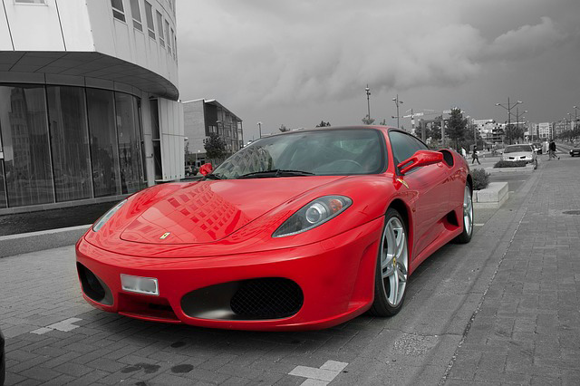
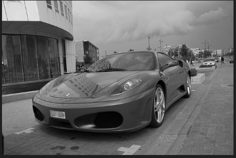
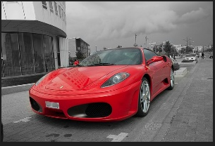
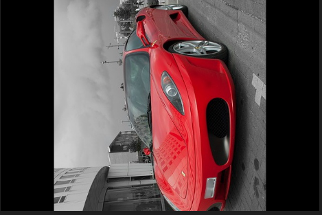
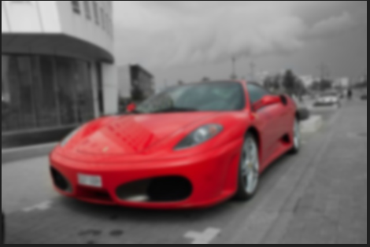
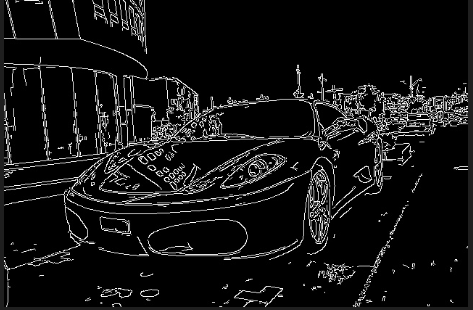
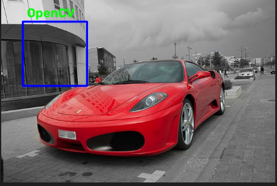
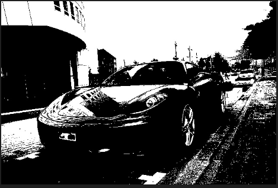
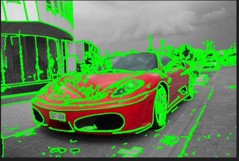

## Imagen Original 

## Lectura y visualización de imágenes

## Convertir una imagen a escala de grises

## Cambiar el tamaño de la imagen

## Girar la imagen 90 grados.

## Aplicación de un desenfoque gaussiano

##  Detección de bordes mediante el algoritmo de Canny

## Dibujar un rectángulo y añadir texto.

## Aplicar umbralización binaria

## Detectar contornos y dibujarlos
